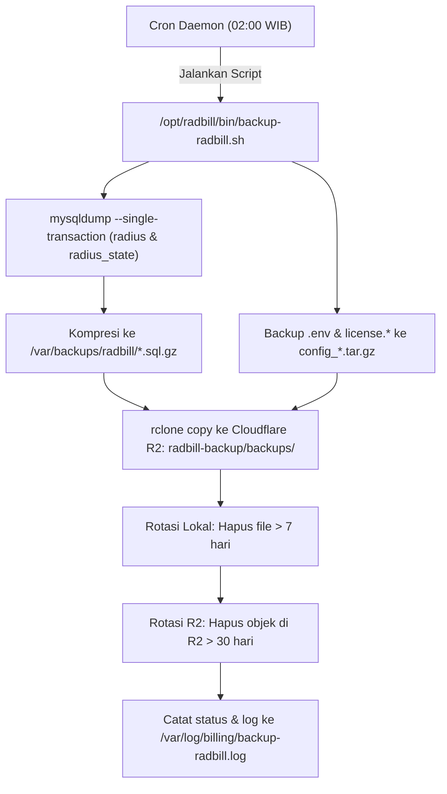

# Dokumentasi Teknis & SOP: Backup Otomatis Radbill (MariaDB & Config) ke Cloudflare R2

Dokumen ini berisi panduan arsitektur, konfigurasi, penjadwalan otomatis, serta Standard Operating Procedure (SOP) Disaster Recovery (Restore) untuk aplikasi **Radbill** dan database **MariaDB/MySQL** (`radius` & `radius_state`) pada server Linux (Debian / Ubuntu / Armbian).

---

## 1. Ringkasan Sistem Radbill

Berdasarkan arsitektur installer (`/opt/radbill`), Radbill menggunakan dua database MariaDB utama serta file lisensi/konfigurasi penting:

| Komponen | Spesifikasi / Konfigurasi |
| :--- | :--- |
| **Aplikasi** | Radbill (Billing, Radius, ACS TR-069, WhatsApp Gateway, Worker) |
| **Direktori Aplikasi** | `/opt/radbill` |
| **Database Engine** | MariaDB / MySQL Server (Port 3306) |
| **Database yang Dibackup** | 1. `radius` (Data utama: Pelanggan, Hotspot, PPPoE, Paket, Tagihan)<br>2. `radius_state` (State: Device ACS/ONT, Tiket, Worker Job Queue) |
| **File Konfigurasi Kritis** | `/opt/radbill/.env`, `/opt/radbill/license.key`, `/opt/radbill/license.cache` |
| **Format Backup DB** | SQL Dump terkompresi Gzip (`.sql.gz`) via `mysqldump` (`--single-transaction`) |
| **Format Backup Config** | Arsip Tar Gzip (`config_*.tar.gz`) |
| **Penyimpanan Lokal** | `/var/backups/radbill/` (Retensi: 7 Hari) |
| **Penyimpanan Cloud** | Cloudflare R2 (S3-Compatible Object Storage) |
| **Tool Sinkronisasi** | `rclone` (Remote: `r2`) |
| **Nama Bucket R2** | `radbill-backup` (Folder: `/backups/`) *(Dapat disesuaikan)* |
| **Jadwal Eksekusi** | Crontab harian pukul 02:00 WIB |
| **File Script** | `/opt/radbill/bin/backup-radbill.sh` |
| **File Log** | `/var/log/billing/backup-radbill.log` |
| **Service Systemd Terkait** | `radbill-api`, `radbill-radius`, `radbill-acs`, `radbill-worker`, `radbill-whatsapp-gateway` |

---

## 2. Diagram Alur Kerja Backup



---

## 3. Langkah Konfigurasi Lengkap

### Langkah 1: Install Tools yang Dibutuhkan

Pastikan `rclone`, `mariadb-client` (mysqldump), dan utilitas pendukung telah terpasang:

```bash
sudo apt update
sudo apt install -y curl rclone gzip tar mariadb-client
```

---

### Langkah 2: Konfigurasi Rclone untuk Cloudflare R2

Buat direktori konfigurasi rclone jika belum ada:
```bash
sudo mkdir -p /root/.config/rclone
```

Edit file `/root/.config/rclone/rclone.conf`:
```bash
sudo nano /root/.config/rclone/rclone.conf
```

Isi dengan konfigurasi berikut:
```ini
[r2]
type = s3
provider = Cloudflare
access_key_id = <R2_ACCESS_KEY_ID>
secret_access_key = <R2_SECRET_ACCESS_KEY>
endpoint = https://<ACCOUNT_ID>.r2.cloudflarestorage.com
acl = private
no_check_bucket = true
```

> **Catatan Penting R2:**
> 1. Ganti `<R2_ACCESS_KEY_ID>`, `<R2_SECRET_ACCESS_KEY>`, dan `<ACCOUNT_ID>` sesuai kredensial Cloudflare R2 Anda.
> 2. Parameter `no_check_bucket = true` wajib ada agar rclone tidak error jika API Token Cloudflare hanya memiliki izin *Object Read & Write*.
> 3. Buat bucket di Cloudflare R2 Dashboard terlebih dahulu (misal bernama `radbill-backup`).

Uji koneksi rclone ke bucket:
```bash
sudo rclone lsd r2:radbill-backup
```
*(Jika tidak muncul error, rclone sudah terhubung dengan baik)*

---

### Langkah 3: Konfigurasi Kredensial Database MariaDB (`/root/.my.cnf`)

Agar script backup otomatis `mysqldump` dapat berjalan tanpa perlu mengetikkan password secara interaktif atau hardcode password di dalam cron script, buat file kredensial MySQL untuk root:

```bash
sudo nano /root/.my.cnf
```

Isi dengan:
```ini
[client]
user = root
password = "radpass123"
```
*(Ganti `radpass123` dengan password root MariaDB server Anda jika berbeda)*

Kunci permission file agar hanya bisa dibaca oleh root:
```bash
sudo chmod 600 /root/.my.cnf
```

> **Verifikasi:** Jalankan `mysql -e "SHOW DATABASES;"`. Jika langsung masuk tanpa meminta password, konfigurasi sudah benar.

---

### Langkah 4: Buat Script Backup (`/opt/radbill/bin/backup-radbill.sh`)

Buat direktori `bin` di `/opt/radbill`:
```bash
sudo mkdir -p /opt/radbill/bin
sudo nano /opt/radbill/bin/backup-radbill.sh
```

Salin script berikut:

```bash
#!/bin/bash
set -e

# ================= Konfigurasi =================
APP_DIR="/opt/radbill"
BACKUP_DIR="/var/backups/radbill"
LOG_DIR="/var/log/billing"
DATE=$(date +"%Y-%m-%d_%H%M%S")

# Database yang akan dibackup
DATABASES=("radius" "radius_state")

# Target Cloudflare R2 (Format: <remote>:<bucket>/<folder>)
R2_REMOTE="r2:radbill-backup/backups"

LOCAL_RETENTION_DAYS=7   # Hapus backup lokal jika lebih dari 7 hari
R2_RETENTION_DAYS=30     # Hapus backup di R2 jika lebih dari 30 hari
# ===============================================

# 1. Pastikan folder backup dan log tersedia
mkdir -p "${BACKUP_DIR}"
mkdir -p "${LOG_DIR}"

echo "=========================================================="
echo "[$(date '+%Y-%m-%d %H:%M:%S')] Memulai proses backup Radbill..."

# 2. Backup Database MariaDB (radius & radius_state)
for DB in "${DATABASES[@]}"; do
    DUMP_FILE="${BACKUP_DIR}/${DB}_${DATE}.sql.gz"
    echo "[$(date '+%Y-%m-%d %H:%M:%S')] Dumping database: ${DB} -> ${DUMP_FILE}..."
    
    # Gunakan --single-transaction agar tidak me-lock tabel selama backup
    mysqldump --defaults-file=/root/.my.cnf \
        --single-transaction \
        --quick \
        --routines \
        --triggers \
        "${DB}" | gzip -c > "${DUMP_FILE}"
        
    echo "[$(date '+%Y-%m-%d %H:%M:%S')] Backup database ${DB} selesai."
done

# 3. Backup File Lisensi & Konfigurasi (.env, license.key, license.cache)
CONFIG_ARCHIVE="${BACKUP_DIR}/radbill_config_${DATE}.tar.gz"
echo "[$(date '+%Y-%m-%d %H:%M:%S')] Mengarsipkan file konfigurasi & lisensi..."

tar -czf "${CONFIG_ARCHIVE}" -C "${APP_DIR}" \
    --ignore-failed-read \
    .env license.key license.cache 2>/dev/null || true

echo "[$(date '+%Y-%m-%d %H:%M:%S')] Arsip config selesai: ${CONFIG_ARCHIVE}"

# 4. Upload seluruh file backup hari ini ke Cloudflare R2
echo "[$(date '+%Y-%m-%d %H:%M:%S')] Mengunggah file ke Cloudflare R2 (${R2_REMOTE})..."
rclone copy "${BACKUP_DIR}" "${R2_REMOTE}" \
    --include "*_${DATE}.sql.gz" \
    --include "*_${DATE}.tar.gz"

echo "[$(date '+%Y-%m-%d %H:%M:%S')] Upload ke R2 berhasil."

# 5. Rotasi Backup Lokal (Hapus file > 7 hari)
echo "[$(date '+%Y-%m-%d %H:%M:%S')] Menjalankan rotasi file lokal (retensi ${LOCAL_RETENTION_DAYS} hari)..."
find "${BACKUP_DIR}" -type f \( -name "*.sql.gz" -o -name "*.tar.gz" \) -mtime +${LOCAL_RETENTION_DAYS} -delete

# 6. Rotasi Backup di Cloudflare R2 (Hapus objek > 30 hari)
echo "[$(date '+%Y-%m-%d %H:%M:%S')] Menjalankan rotasi di Cloudflare R2 (retensi ${R2_RETENTION_DAYS} hari)..."
rclone delete --min-age ${R2_RETENTION_DAYS}d "${R2_REMOTE}"

echo "[$(date '+%Y-%m-%d %H:%M:%S')] Backup dan rotasi Radbill selesai dengan sukses!"
echo "=========================================================="
```

Beri izin eksekusi:
```bash
sudo chmod +x /opt/radbill/bin/backup-radbill.sh
```

Uji jalankan backup manual:
```bash
sudo /opt/radbill/bin/backup-radbill.sh
```
Periksa apakah file berhasil dibuat di `/var/backups/radbill/` dan terunggah ke Cloudflare R2:
```bash
ls -lh /var/backups/radbill/
sudo rclone ls r2:radbill-backup/backups
```

---

### Langkah 5: Penjadwalan Otomatis via Crontab

Buka editor crontab untuk user `root`:
```bash
sudo crontab -e
```

Tambahkan baris berikut di akhir file:
```cron
# Backup Otomatis Radbill ke Cloudflare R2 setiap pukul 02:00 WIB
0 2 * * * /opt/radbill/bin/backup-radbill.sh >> /var/log/billing/backup-radbill.log 2>&1
```

> **Catatan Waktu Server:**  
> Pastikan zona waktu server sudah `Asia/Jakarta`:
> ```bash
> timedatectl set-timezone Asia/Jakarta
> timedatectl
> ```

---

## 4. Standard Operating Procedure (SOP) Restore / Pemulihan

Jika sewaktu-waktu terjadi kerusakan data atau bencana server (Disaster Recovery), ikuti prosedur di bawah ini:

### Skenario 1: Restore Database dari Backup Lokal (Tersedia dalam 7 Hari)

Misal terjadi salah hapus data pelanggan atau ingin *rollback* ke tanggal tertentu:

1. **Hentikan sementara service Radbill** agar tidak ada penulisan data baru saat proses restore:
   ```bash
   sudo systemctl stop radbill-api radbill-worker radbill-radius radbill-acs radbill-whatsapp-gateway
   ```

2. **Pilih file backup yang ingin di-restore:**
   ```bash
   ls -la /var/backups/radbill/
   ```

3. **Restore Database `radius`:**
   ```bash
   gunzip < /var/backups/radbill/radius_YYYY-MM-DD_HHMMSS.sql.gz | mysql --defaults-file=/root/.my.cnf radius
   ```

4. **Restore Database `radius_state` (Jika diperlukan):**
   ```bash
   gunzip < /var/backups/radbill/radius_state_YYYY-MM-DD_HHMMSS.sql.gz | mysql --defaults-file=/root/.my.cnf radius_state
   ```

5. **Nyalakan kembali seluruh service Radbill:**
   ```bash
   sudo systemctl start radbill-api radbill-worker radbill-radius radbill-acs radbill-whatsapp-gateway
   ```

6. **Verifikasi status service:**
   ```bash
   sudo systemctl status radbill-api radbill-worker
   ```

---

### Skenario 2: Disaster Recovery Penuh dari Cloudflare R2 (Server Baru / Rusak Total)

Gunakan skenario ini jika server lama rusak total dan Anda menyiapkan server baru:

1. **Pasang server baru dengan Radbill Installer (`installer-linux-amd64` atau `installer-linux-arm64`)** sampai selesai, sehingga MariaDB dan service `systemd` terkonfigurasi.

2. **Hentikan service Radbill:**
   ```bash
   sudo systemctl stop radbill-api radbill-worker radbill-radius radbill-acs radbill-whatsapp-gateway
   ```

3. **Setup rclone** pada server baru (lihat Langkah 2 di atas).

4. **Cek file yang tersedia di Cloudflare R2:**
   ```bash
   sudo rclone ls r2:radbill-backup/backups
   ```

5. **Unduh file backup database dan config yang diinginkan ke direktori `/tmp`:**
   ```bash
   sudo rclone copy r2:radbill-backup/backups/radius_<TIMESTAMP>.sql.gz /tmp/
   sudo rclone copy r2:radbill-backup/backups/radius_state_<TIMESTAMP>.sql.gz /tmp/
   sudo rclone copy r2:radbill-backup/backups/radbill_config_<TIMESTAMP>.tar.gz /tmp/
   ```

6. **Kosongkan dan Siapkan Database Bersih:**
   ```bash
   mysql -u root -p -e "DROP DATABASE IF EXISTS radius; CREATE DATABASE radius CHARACTER SET utf8mb4 COLLATE utf8mb4_general_ci;"
   mysql -u root -p -e "DROP DATABASE IF EXISTS radius_state; CREATE DATABASE radius_state CHARACTER SET utf8mb4 COLLATE utf8mb4_general_ci;"
   ```

7. **Lakukan Restore Database:**
   ```bash
   gunzip < /tmp/radius_<TIMESTAMP>.sql.gz | mysql -u root -p radius
   gunzip < /tmp/radius_state_<TIMESTAMP>.sql.gz | mysql -u root -p radius_state
   ```

8. **Restore Konfigurasi & Lisensi Radbill:**
   ```bash
   sudo tar -xzf /tmp/radbill_config_<TIMESTAMP>.tar.gz -C /opt/radbill/
   sudo chown root:root /opt/radbill/.env /opt/radbill/license.key /opt/radbill/license.cache
   sudo chmod 600 /opt/radbill/.env
   ```

9. **Mulai Service Radbill:**
   ```bash
   sudo systemctl start radbill-api radbill-worker radbill-radius radbill-acs radbill-whatsapp-gateway
   ```

10. **Bersihkan file sementara di `/tmp`:**
    ```bash
    rm -f /tmp/radius_*.sql.gz /tmp/radius_state_*.sql.gz /tmp/radbill_config_*.tar.gz
    ```

---

## 5. Monitoring & Maintenance

| Perintah | Fungsi |
| :--- | :--- |
| `tail -n 50 /var/log/billing/backup-radbill.log` | Memeriksa log eksekusi backup terakhir |
| `sudo /opt/radbill/bin/backup-radbill.sh` | Eksekusi backup manual sewaktu-waktu |
| `rclone ls r2:radbill-backup/backups` | Menampilkan seluruh file yang ada di Cloudflare R2 |
| `rclone size r2:radbill-backup/backups` | Menghitung total ukuran file & kuota R2 yang terpakai |
| `mysqlcheck -u root -p --auto-repair --check radius radius_state` | Pengecekan integritas tabel database MariaDB |
